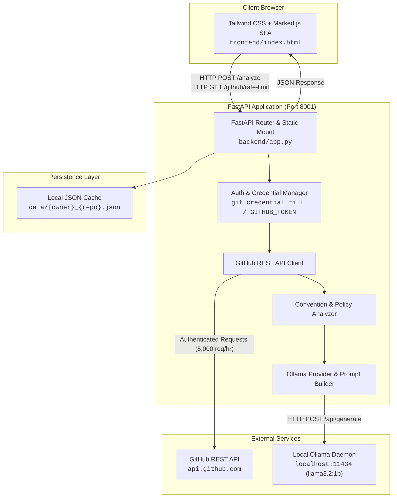
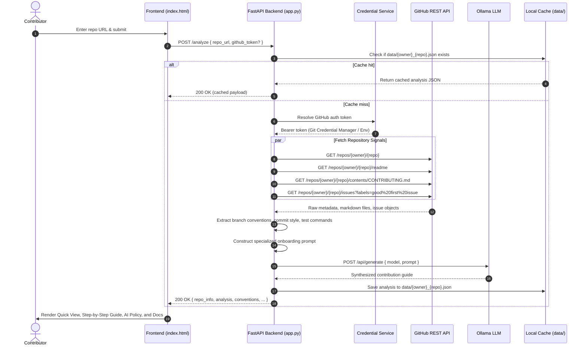

# System Architecture

The **OSS Contributor Assistant** is an intelligent developer onboarding tool that accelerates contribution to open-source repositories. It ingests repository signals (metadata, issues, pull request templates, contribution guides, and licenses) from GitHub and synthesizes actionable onboarding steps, dynamic branching conventions, beginner-friendly issue recommendations, and AI usage policies using local language models (Ollama).

---

## 1. High-Level Architecture

The system is designed with a lightweight, decoupled 3-tier architecture:

---

## 2. Component Breakdown

### 2.1 Frontend Presentation Layer (`frontend/index.html`)
- **Technology**: Vanilla HTML5, Tailwind CSS (CDN), Marked.js for markdown rendering.
- **Responsibilities**:
  - Accepts repository URLs (e.g., `https://github.com/pallets/flask` or `owner/repo`).
  - Displays a live **GitHub Rate Limit Quota Pill** in the top navigation bar.
  - Provides an optional drawer for custom personal access tokens.
  - Renders dynamic results cleanly:
    - **Branch & Naming Conventions Quick View** (Base branch, branch naming pattern, commit style, testing command).
    - **AI Contribution Policy Card** (Allowed / Limited / Unknown with contextual reasons).
    - **Curated Beginner Issues** (Direct issue links and entry rationale).
    - **Step-by-Step Contribution Workflow** (Forking, branching, coding, testing, PR submission).
    - **Expandable Document Viewers** for `CONTRIBUTING.md` and `README.md` with upstream GitHub links.

### 2.2 FastAPI Server Layer (`backend/app.py`)
- **Single Process Hosting**: Serves both RESTful JSON endpoints (`/analyze`, `/github/rate-limit`, `/health`) and mounts `frontend/` statically at `/` for frictionless zero-configuration setup.
- **Auto-Discovery & Diagnostics**:
  - Automatically pings Ollama (`/api/tags`) on startup and selects the best available lightweight model (preferring `llama3.2:1b` for fast local inference).

### 2.3 Authentication & Rate Limit Manager
GitHub restricts unauthenticated requests to 60 requests/hour per IP, quickly causing `403 rate limit exceeded` errors. The authentication service implements a robust 3-tier discovery hierarchy:
1. **Explicit Request Token**: Passed by the user in the web UI.
2. **Environment Variable**: `GITHUB_TOKEN` from system environment or `.env`.
3. **Git Credential Manager CLI**: Automatically queries `git credential fill` to retrieve credentials already configured on the developer's workstation.

*Result: Seamless 5,000 requests/hour quota without requiring manual API token setup.*

### 2.4 Context Extraction & Convention Analyzer
Rather than feeding raw, unparsed documents to the LLM, the backend analyzes repository signals first:
- **Default Base Branch**: Reads the default branch from the repository metadata (e.g., `main`, `master`, `develop`).
- **Branch Naming Pattern**: Searches `CONTRIBUTING.md` and repository guidelines for branch conventions (e.g., `feature/*`, `fix/*`, `username/issue-123`).
- **Commit Style**: Identifies whether the project enforces Conventional Commits (`feat:`, `fix:`, `docs:`) or free-form messages.
- **Test Command**: Automatically discovers test execution patterns (`pytest`, `npm test`, `cargo test`, `go test`).
- **AI Policy Scraper**: Looks for explicit policies regarding generative AI usage and disclosures in contribution guides.

### 2.5 Local LLM Provider (Ollama)
- Communicates with Ollama running locally at `http://localhost:11434`.
- Uses temperature-controlled, structured prompts with strict system instructions to guarantee predictable, well-formatted markdown output.
- Operates 100% locally: repository context and proprietary tokens never leave the local machine.

### 2.6 Persistence Layer (`data/`)
- Caches analysis runs in `data/{owner}_{repo}.json`.
- Subsequent analyses for the same repository load instantaneously without consuming GitHub API quota or Ollama compute cycles.

---

## 3. End-to-End Execution Flow

---

## 4. SOLID Engineering Principles

The architecture follows SOLID standards to ensure maintainability and long-term extensibility:

| Principle | Implementation Details |
| :--- | :--- |
| **S — Single Responsibility** | Separate modules and helper functions handle discrete concerns: `get_authenticated_headers` for credentials, `detect_branching_and_conventions` for regex signal parsing, `query_ollama` for LLM inference, and file I/O routines for cache storage. |
| **O — Open / Closed** | The LLM provider and Git host layers are designed to be swappable (e.g. extending from GitHub to GitLab/Gitea, or Ollama to Gemini/OpenAI) without modifying route contracts. |
| **L — Liskov Substitution** | The backend accepts any standard OpenAI/Ollama compatible endpoint returning string completions. |
| **I — Interface Segregation** | Frontend clients interact via fine-grained REST endpoints (`/github/rate-limit` for quota monitoring, `/analyze` for full ingestion). |
| **D — Dependency Inversion** | High-level route handlers depend on abstract functional interfaces and runtime discovery rather than hardcoded client instances. |

---

## 5. Security & Privacy

1. **Zero Credential Storage**: GitHub tokens provided in the UI or retrieved from the Git Credential Manager are used in-memory for the duration of the request and are never written to disk or logged.
2. **Local Inference**: Code analysis and LLM summarization happen entirely on the developer's machine through Ollama; no proprietary repository source is transmitted to third-party AI APIs.
3. **Data Hygiene**: The `data/` directory caching analysis artifacts is excluded in `.gitignore` to prevent committing repository cache dumps or telemetry.
